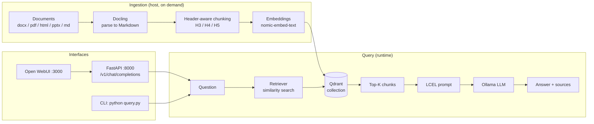

# Archivist

**Ask questions about your own documents. Nothing ever leaves the machine.**


A fully local RAG (Retrieval-Augmented Generation) pipeline built with LangChain/LCEL, Qdrant and Ollama. Parsing, embedding, indexing and generation all happen on your own hardware — no API keys, no external calls, no data leaving the box. Built for the kind of internal documentation that can't be uploaded to a cloud service.

> **Status: alpha.** It works and is in daily use, but there are no automated tests and no systematic evaluation of retrieval quality yet. Interfaces and index format may change without notice. See [Known limitations](#known-limitations) and [Roadmap](#roadmap).

---

## Contents

- [How it works](#how-it-works)
- [Requirements](#requirements)
- [Quick start](#quick-start)
- [Connecting Open WebUI](#connecting-open-webui)
- [Repository layout](#repository-layout)
- [Configuration](#configuration)
- [Usage](#usage)
- [API](#api)
- [Design decisions](#design-decisions)
- [Known limitations](#known-limitations)
- [Roadmap](#roadmap)
- [Troubleshooting](#troubleshooting)
- [License](#license)

---

## How it works



Two distinct phases:

1. **Ingestion** — `ingest.py` reads your documents, converts them to Markdown with Docling, splits them into chunks that respect the heading hierarchy, computes embeddings and writes everything to Qdrant. Runs on the host, on demand, whenever documents change.
2. **Query** — `api.py` exposes an LCEL chain that retrieves the chunks closest to the question and passes them to the model as context. The endpoint speaks the OpenAI protocol, so any standard client (Open WebUI included) can talk to it.

## Requirements

| Component | Version | Runs on | Notes |
|---|---|---|---|
| [Ollama](https://ollama.com) | 0.3+ | **host** (native) | direct GPU/RAM access |
| Docker + Docker Compose | v2 | host | Qdrant, API, Open WebUI |
| Python | 3.11+ | host | ingestion and CLI only |

Rough minimum with the default models: **8 GB RAM**. With more memory, switching to a larger LLM is the single highest-impact change you can make (see `LLM_MODEL` in `.env`).

> On Windows, everything is designed to run under **WSL2**, with Ollama installed inside WSL and Docker Desktop's WSL integration enabled.

## Quick start

```bash
git clone https://github.com/<your-user>/archivist.git
cd archivist

# 1. Config + Python dependencies
make setup          # copies .env.example -> .env and installs requirements
$EDITOR .env        # check DOCS_PATH and LLM_MODEL at minimum

# 2. Ollama models (once)
make models

# 3. Docker stack: Qdrant + API + Open WebUI
make up

# 4. Drop documents into data/docs/ (or point DOCS_PATH elsewhere) and index them
make ingest

# 5. Verify
make health         # {"status": "ok", "vectors": 1234, ...}
```

Then open **http://localhost:3000** for the chat UI, or ask from the terminal with `make ask`.

Tip: create a virtual environment before step 1 (`python -m venv .venv && source .venv/bin/activate`, or `conda create -n archivist python=3.11`). Docling downloads a few hundred MB of layout models on first use.

## Connecting Open WebUI

`docker-compose.yml` preconfigures Open WebUI with `OPENAI_API_BASE_URL: http://rag-api:8000/v1`, so the **`rag-internal`** model should already appear in the model picker on first launch.

If it doesn't, add it manually:

1. *Settings → Connections → OpenAI API*
2. **URL**: `http://rag-api:8000/v1` — **API key**: anything (it isn't checked)
3. Save and reload — `rag-internal` shows up in the dropdown.

> Make sure you select `rag-internal`, not a direct Ollama model. Only the former goes through the RAG pipeline; the others talk to Ollama with no document context at all.

## Repository layout

```
archivist/
├── app/
│   ├── config.py            # centralised configuration (reads .env)
│   ├── ingest.py            # parse + chunk + embed + upsert into Qdrant
│   ├── query.py             # LCEL chain + interactive CLI
│   ├── api.py               # FastAPI: native + OpenAI-compatible endpoints
│   └── inspect_docling.py   # diagnostics: what Markdown does Docling produce?
├── scripts/
│   └── setup-models.sh      # ollama pull for the models named in .env
├── docs/
│   └── architecture.md      # longer architecture notes
├── data/                    # gitignored: documents, Qdrant index, WebUI state
├── docker-compose.yml
├── Dockerfile               # API service image
├── Makefile                 # shortcuts (make help)
├── requirements.txt         # host environment (includes Docling)
├── requirements-api.txt     # API container (no Docling)
└── .env.example
```

> Source comments and docstrings are in Italian: this started as a learning project and those comments are the notes that came with it. Everything user-facing is in English.

## Configuration

All configuration lives in `.env` (see `.env.example` for the annotated list). The knobs you'll actually turn:

| Variable | Default | What it does |
|---|---|---|
| `LLM_MODEL` | `phi3:mini` | generation model; first thing to change on better hardware |
| `EMBEDDING_MODEL` | `nomic-embed-text` | embedding model — changing it requires a matching `EMBEDDING_DIM` **and** a full reindex |
| `DOCS_PATH` | `data/docs` | document folder; relative to the repo root, or absolute |
| `TOP_K` | `6` | how many chunks go into the context |
| `LLM_NUM_CTX` | `4096` | context window; Ollama's default of 2048 is too small, see below |
| `ENABLE_QUERY_EXPANSION` | `false` | generate question variants before searching: better recall, much higher latency |
| `CHUNK_SIZE` / `CHUNK_OVERLAP` | `1500` / `300` | only used when re-splitting oversized fields |

## Usage

```bash
make ingest                              # index new or modified documents
make reset                               # wipe the collection and reindex everything
cd app && python ingest.py --file x.docx # a single file

make ask                                 # interactive terminal session
cd app && python query.py -q "how do I configure X?"
cd app && python query.py --debug        # show expanded queries (when enabled)

cd app && python inspect_docling.py --redact   # inspect Docling's output

make logs                                # follow API logs
make down                                # stop the stack
```

A **modified** document is reindexed automatically: its content hash changes, and the previous version's chunks are deleted before the new ones are written. A document **deleted** from disk, however, stays in the index until you run `make reset` (see [Roadmap](#roadmap)).

## API

The API documents itself: open **http://localhost:8000/docs** for interactive Swagger.

| Method | Endpoint | Description |
|---|---|---|
| `GET` | `/health` | API status and indexed vector count |
| `GET` | `/sources` | indexed documents with chunk counts |
| `POST` | `/query` | full answer + sources (JSON) |
| `POST` | `/query/stream` | SSE streaming answer, sources sent as the first event |
| `POST` | `/v1/chat/completions` | OpenAI-compatible (streaming and not) |
| `GET` | `/v1/models` | model list, required by Open WebUI |

```bash
curl -s http://127.0.0.1:8000/query \
  -H 'Content-Type: application/json' \
  -d '{"question": "what are the steps of the escalation procedure?"}' | python -m json.tool
```

## Design decisions

The non-obvious choices, and why:

**Header-aware chunking instead of fixed-size splitting.** The source documents follow a regular template: a procedure title, then twenty-odd fields of wildly varying length. A 1500-character splitter ignores those boundaries entirely — it merges unrelated fields into one chunk, or cuts one in half. `ingest.py` splits on headings instead, and classifies each field four ways: dropped by name (administrative fields), dropped as empty, merged into a single `Attributes` chunk if short but meaningful, or kept as a standalone chunk if substantial. Every standalone chunk carries its *context path* (`[Procedure > Field > Subfield]`) as a prefix, so it stays interpretable to the embedding model even in isolation.

**Metadata is nested under a `metadata` key in the Qdrant payload.** Not a style preference: `QdrantVectorStore` from `langchain-qdrant` defaults `metadata_payload_key` to `"metadata"` and does `payload.get("metadata") or {}`. With a flat payload that lookup always returns `{}`, and every `Document` reaches the retriever with empty metadata — meaning answers with no sources, and no error anywhere to tell you why.

**`num_ctx` explicitly set to 4096.** Ollama defaults to 2048 tokens. System prompt + `TOP_K` chunks + `num_predict` blows past that easily: the context window slides mid-generation, the system instructions fall out of it, and the model keeps writing with no idea what it was asked to do. It's the most common cause of answers that start well and degenerate.

**Open WebUI's background requests bypass RAG.** Open WebUI fires automatic requests to generate conversation titles, tags and follow-up questions. They all start with `### Task:`. Without intercepting them, every user message would trigger three or four pointless retrievals and generations.

**Query expansion off by default.** `MultiQueryRetriever` makes four or more sequential LLM calls before retrieval even starts. On a small model that's several seconds before the first token. Turn it on with `ENABLE_QUERY_EXPANSION=true` when quality matters more than latency.

**Ollama outside Docker.** Direct access to the GPU and to models already present on the host, without another virtualisation layer in between. Containers reach it via `host.docker.internal`.

More detail in [`docs/architecture.md`](docs/architecture.md).

## Known limitations

- **No automated tests and no retrieval evaluation.** There's no golden question/answer set: quality is judged by eye.
- **Tables stay as raw Markdown.** Pipes and dashes go into the embedding as-is; tabular content is the weakest part of the pipeline.
- **Vector search only.** No keyword matching, so a rare acronym or an identifier code may not be found even though it's right there in the documents.
- **No similarity threshold.** The `TOP_K` nearest chunks are always passed to the model, even when none of them is actually relevant. The prompt tells the model to say it found nothing, but that isn't a guarantee.
- **No conversational memory.** Each question is independent: "and what about the next step?" won't work.
- **Deleted documents stay indexed** until a `--reset`.
- **Chunking thresholds are tuned to one specific template.** On differently structured documents they need revisiting (`NEAR_EMPTY_CHARS`, `MIN_CHUNK_CHARS`, `ADMIN_FIELDS_BLACKLIST`, `HEADERS_TO_SPLIT_ON` in `ingest.py`).

## Roadmap

- [ ] Evaluation harness: golden Q&A dataset + `evaluate.py`
- [ ] Table to natural-language conversion before embedding
- [ ] Hybrid search: Qdrant sparse vectors + BM25 with RRF fusion
- [ ] Local cross-encoder reranker over retrieved candidates
- [ ] Similarity threshold, to avoid answering from irrelevant context
- [ ] Structured, filterable metadata (procedure type, owner, date)
- [ ] Filesystem watcher for automatic incremental ingestion
- [ ] Remove documents from the index when deleted from disk
- [ ] Multi-turn conversational memory
- [ ] Qdrant volume backup/restore

## Troubleshooting

**`Connection refused` reaching Ollama from the containers**
Ollama listens on `127.0.0.1` by default and isn't reachable from the Docker network. Bind it to all interfaces: `OLLAMA_HOST=0.0.0.0 ollama serve` (or set `Environment="OLLAMA_HOST=0.0.0.0"` in the systemd unit and restart the service).

**Answers cite no sources**
Almost always means flat-metadata payloads written by an older version. Check with `curl -s localhost:8000/sources`: if everything reads `unknown`, run `make reset`.

**The model goes incoherent after a few lines**
Saturated context. Raise `LLM_NUM_CTX` (if the model supports it) or lower `TOP_K`.

**The first answer takes forever**
That's Ollama loading the model into memory; later ones are much faster. If it happens on every question, check `OLLAMA_KEEP_ALIVE`.

**`make ingest` finds nothing**
Wrong `DOCS_PATH`, or unsupported extensions. Supported formats are `.pdf .docx .html .htm .pptx .md .txt`. The resolved path is printed when the script starts.

**Docling downloads models on first run**
Expected: a few hundred MB of layout analysis models, fetched once and cached.

## License

MIT — see [LICENSE](LICENSE).

Indexed documents and the Qdrant index stay out of the repository (`data/` is gitignored). Before making a fork public, double-check that no internal content has been committed.
